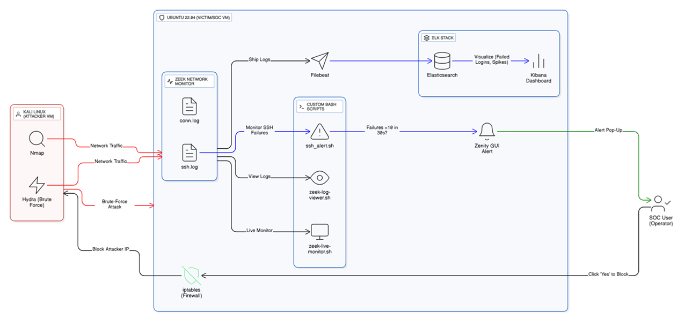
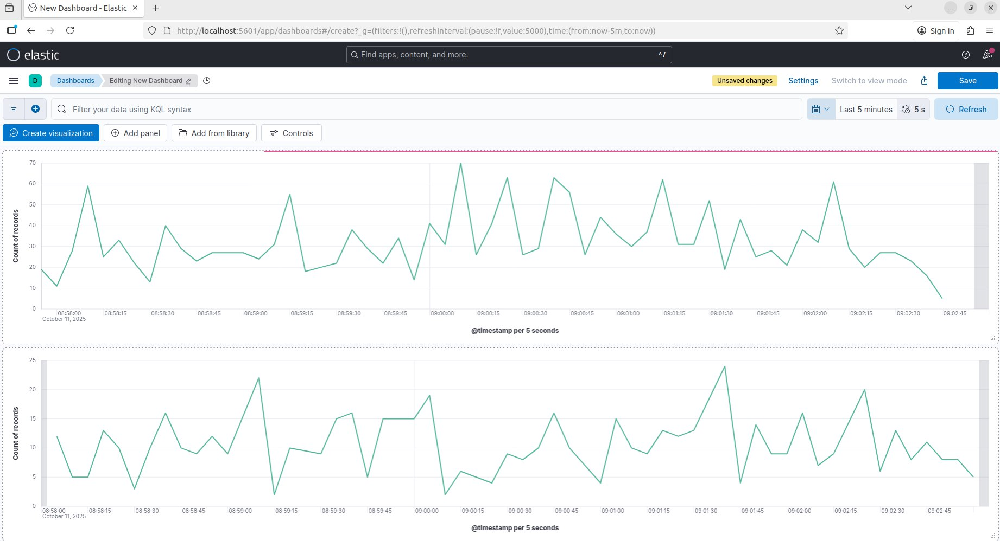
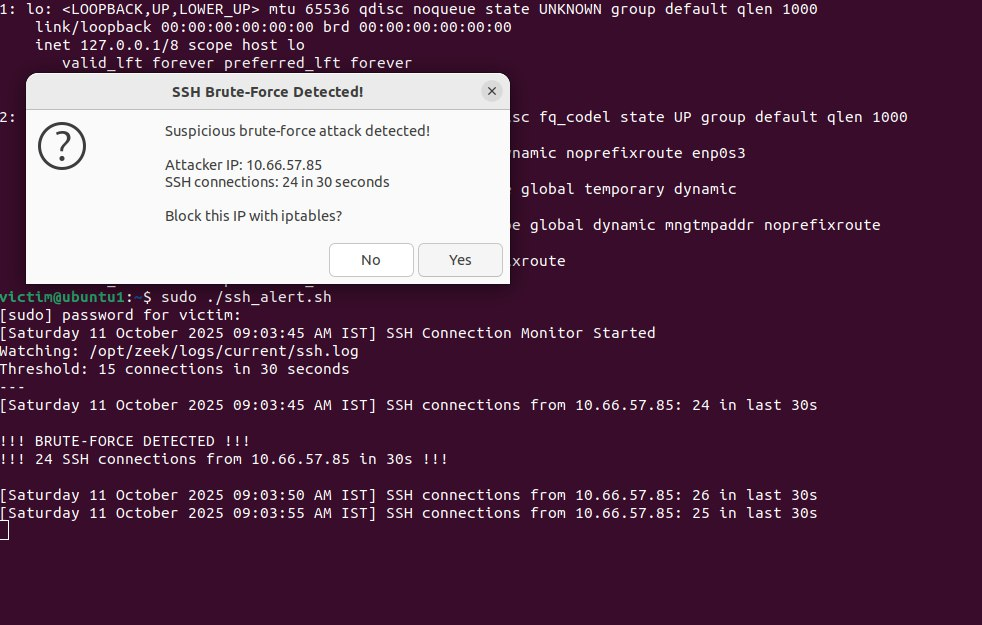
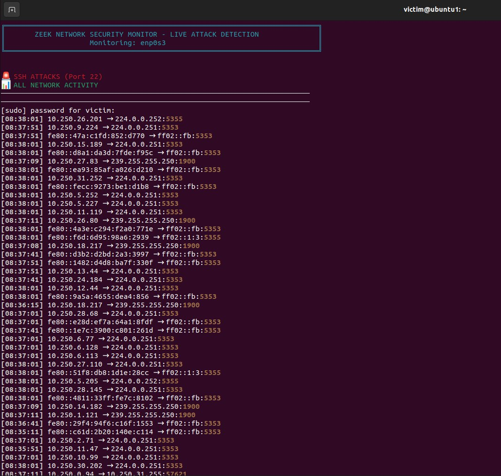

# Real-Time Threat Hunting with Zeek and ELK Stack

## Description
This project is a real-time cybersecurity demo built for a college expo. It simulates threat hunting in a Security Operations Center (SOC) using open-source tools. The system detects network attacks like port scanning (via Nmap) and SSH brute-force (via Hydra) on a victim machine, logs them with Zeek, visualizes spikes in Kibana, and provides alerts/blocking via custom scripts.

- **Attacker VM**: Kali Linux simulates threats.
- **Victim/SOC VM**: Ubuntu 22.04 runs Zeek for monitoring, ELK Stack for storage/visualization, and custom Bash scripts for enhanced detection/response.
- **Key Features**:
  - Real-time log monitoring with clean, colored outputs.
  - Graphical alerts for brute-force attempts (threshold: >10 failures in 30 seconds).
  - Automatic IP blocking with iptables on user confirmation.
  - Kibana dashboards for visual spikes in failed logins.

This repo contains custom scripts, documentation, and visuals. Feel free to clone and run it!

## Features
- **Detection**: Zeek captures traffic and logs suspicious activity (e.g., `conn.log` for scans, `ssh.log` for SSH failures).
- **Visualization**: Kibana shows line charts of failed logins (filter: `zeek.ssh.auth_success: false`).
- **Monitoring & Alerts**: Custom scripts format logs, monitor live, and trigger pop-ups.
- **Response**: Block attacker IPs dynamically.
- **Open-Source**: All tools are free; extendable for more threats (e.g., DNS tunneling).

## Requirements
- Two VMs: Kali Linux (attacker) and Ubuntu 22.04 (victim/SOC).
- Installed on Ubuntu:
  - Zeek: `sudo apt install zeek`
  - ELK Stack: `sudo apt install elasticsearch kibana filebeat`
  - Zenity (for GUI alerts): `sudo apt install zenity`
- On Kali: Hydra and Nmap (pre-installed).

## Installation
1. Clone this repo: `git clone https://github.com/mighty-baseplate/zeek-threat-hunting-demo`
2. Set up Zeek on Ubuntu: `sudo zeekctl deploy`
3. Configure Filebeat to ship Zeek logs: Edit `/etc/filebeat/filebeat.yml` with paths to `/opt/zeek/logs/current/*.log` and hosts `localhost:9200`.
4. Start services: `sudo systemctl start elasticsearch kibana filebeat`
5. Copy scripts to Ubuntu: Place in `~/scripts` and make executable: `chmod +x *.sh`
6. Edit Zeek config: Add `@load protocols/ssh/detect-bruteforcing` to `/opt/zeek/share/zeek/site/local.zeek`, then `sudo zeekctl deploy`.

## Usage / Demo Flow
1. **Start Monitoring on Ubuntu**:
   - Run live monitor: `./zeek-live-monitor.sh` (shows real-time connections/attacks with colors).
   - Run log viewer: `./zeek-log-viewer.sh ssh` (formatted tables for specific logs).
   - Run alert script: `sudo ./ssh_alert.sh` (monitors and pops alert on threshold).

2. **Simulate Attack from Kali**:
   - Brute-force: `hydra -l victim -P /usr/share/wordlists/rockyou.txt ssh://<ubuntu-ip> -t 16 -V -I` (replace `<ubuntu-ip>` with Ubuntu's IP, e.g., 10.54.164.253).

3. **Observe**:
   - Logs flood in terminals.
   - Kibana (`localhost:5601`) shows spike.
   - Alert pops: Click "Yes" to block IP.

4. **Block/Unblock Commands**:
   - Check block: `sudo iptables -L INPUT -n | grep <kali-ip>` (e.g., 10.54.164.85).
   - Unblock: `sudo iptables -D INPUT -s <kali-ip> -j DROP`.

5. **Stop Attack**: Ctrl+C on Hydra; no new logs/spikes after block.

## Scripts Explanation
- **zeek-log-viewer.sh**: Formats Zeek logs (conn/ssh/dns/http) into clean tables with colors. Usage: `./zeek-log-viewer.sh [conn|ssh|all]`.
- **zeek-live-monitor.sh**: Real-time viewer with split sections for SSH attacks and connections. Highlights suspicious activity. Usage: `./zeek-live-monitor.sh`.
- **ssh_alert.sh**: Monitors ssh.log, counts failures, shows Zenity pop-up if threshold hit, blocks IP if "Yes". Usage: `sudo ./ssh_alert.sh`.

## Screenshots
- Kibana Spike: 
- Alert Pop-up: 
- Terminal Logs: 

## License
MIT License - See [LICENSE](LICENSE) for details.

## Acknowledgments
- Inspired by MITRE ATT&CK framework and open-source tools like Zeek/ELK.
